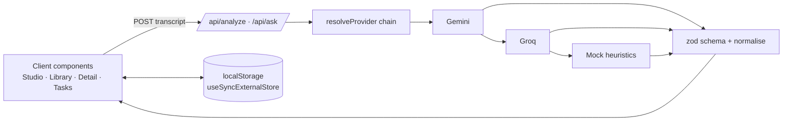

# CHANGES — what changed and why

Written so each change can be explained in an interview. Short version: I turned a half-working "paste text → OpenAI → regex" prototype into a typed, tested, key-optional app with a provider abstraction and a cohesive product around it.

## Architecture

- `src/lib/ai/` — provider interface, Gemini/Groq clients (plain `fetch`), mock, zod schema, prompts, selector with fallback.
- `src/lib/transcript.ts` — pure parsing (speaker turns, VTT/SRT cleanup, stats).
- `src/lib/storage.ts` — pure list helpers + a `useMeetings()` hook built on `useSyncExternalStore` (SSR-safe, updates across tabs).
- `src/components/` — UI. `src/app/` — thin routes.
- Why this shape: all logic lives in pure, testable modules; the UI and routes are thin.

## Feature by feature

1. **TypeScript migration** — The data crossing the LLM boundary is untyped JSON; types + runtime validation catch bad output before the UI sees it. Also fixed the ESLint config that referenced a nonexistent TS setup.
2. **Provider abstraction + mock mode** — *Why:* OpenAI was paid and hard-wired. Now one `AIProvider` interface; Gemini/Groq are free. `AI_PROVIDER=auto` picks a configured key. If a call fails (429/503/timeouts — which I actually hit), it cascades to the next provider then to the offline mock, and the UI shows why. The app is fully usable with no keys.
3. **Structured output instead of regex** — The old UI scraped bullets/keywords out of prose. Now the model is prompted for a fixed JSON shape (JSON mode on Gemini/Groq), `extractJson` tolerates fences/chatter, and `normalizeAnalysis` (zod) coerces priorities/sentiment, trims, caps sizes, and rejects empties.
4. **Offline heuristic analyzer** — Deterministic: TF-weighted sentence ranking for key points, regex patterns for commitments/decisions/due dates, speaker-attribution (and "Can you…, Dana?" → Dana owns it), lexicon sentiment, topic extraction minus speaker names. Not an LLM, but gives a convincing demo and tests without network.
5. **Local-first storage** — Replaced Supabase (missing dependency, undocumented schema, insecure shared anon writes). Zero setup, private. Trade-off documented.
6. **Studio page** — sample transcripts, `.txt/.vtt/.srt` upload (subtitle cleanup), live word/speaker count, limits, skeleton loading, inline error banners (no more `alert()`), provider badge.
7. **Meeting detail** — tabs: Notes (checkable action items), Transcript with speaker colouring and **talk-time bars**, **Ask this meeting** (LLM or keyword retrieval), generated **follow-up email**, Markdown export, delete.
8. **Library** — searchable card grid; skeleton, empty and no-results states.
9. **Tasks board** — cross-meeting action items, filter by open/done/owner, sorted by priority; open-count badge in the nav. This is the "so what" of meeting notes.
10. **API hardening** — body/JSON validation, length limits (413), question limits, no stack leaks, server-side keys only.
11. **Design** — dark gradient + aurora glow, glass surfaces, pill nav, big display type (inspired by vibrant.design); responsive, keyboard-focus rings, `aria-live`, reduced-motion support.
12. **Tests & tooling** — vitest (19 tests): transcript parsing, schema normalisation, mock analyzer, provider selection/fallback (stubbed `fetch`), storage helpers. `lint`, `typecheck`, `build` all pass.

## Interview talking points

- *Why a fallback chain?* Free tiers rate-limit; users should still get a result.
- *Why `useSyncExternalStore`?* Correct way to subscribe to an external store (localStorage) without hydration mismatches or setState-in-effect.
- *Why not trust model JSON?* LLMs return fences, extra prose, wrong enums — validate at the boundary.
- *Why drop the database?* Honest trade-off: simplicity/privacy vs sync; storage is behind a small module so it can be swapped.
- *Bug I found live:* default model IDs had been retired → made models configurable + alias defaults, and the fallback masked the outage.
