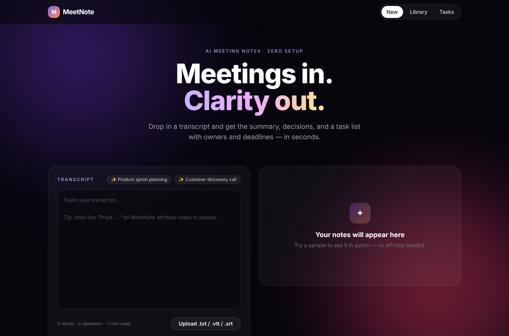
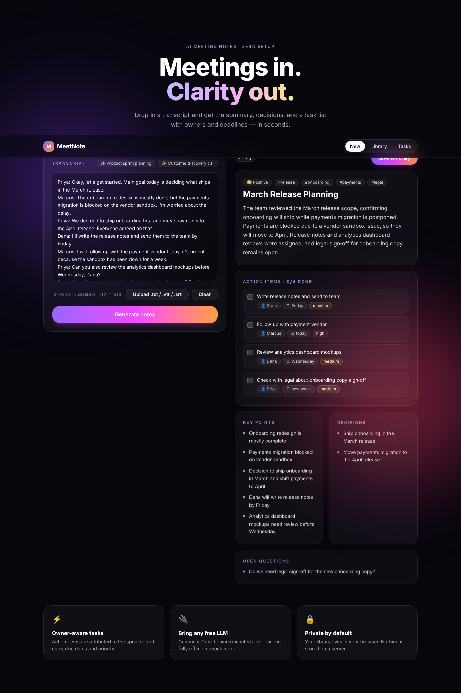
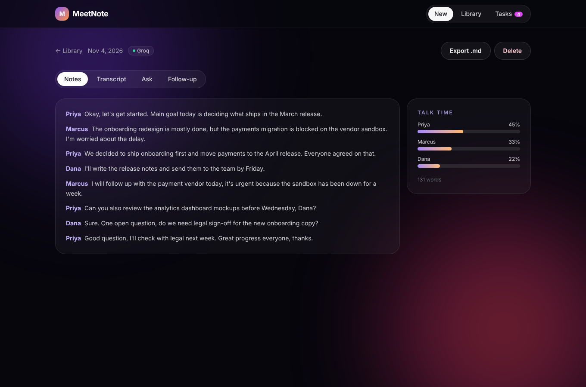
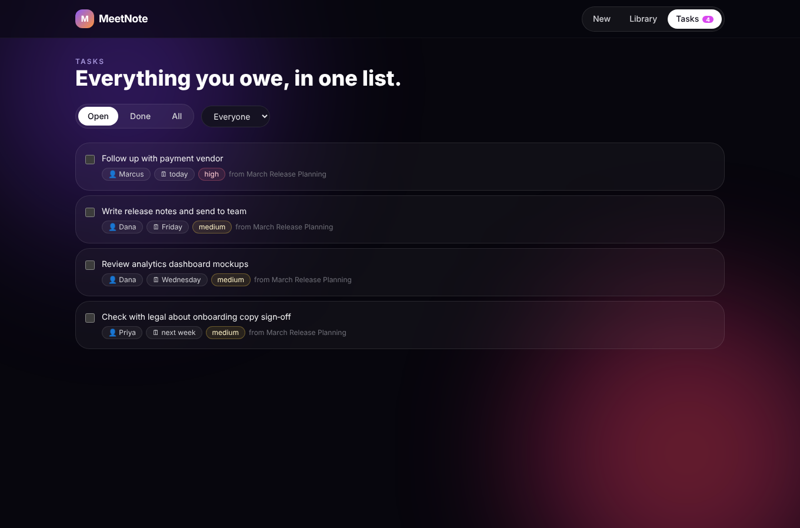
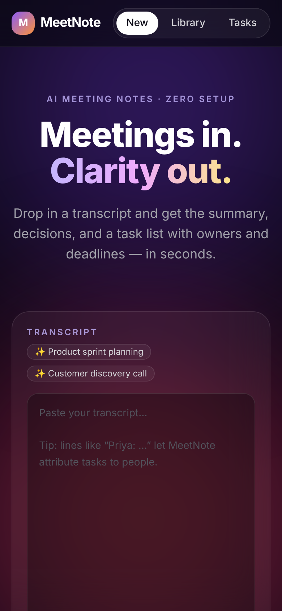
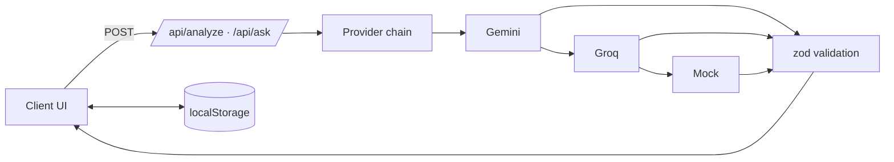

<div align="center">

# MeetNote

**Meetings in. Clarity out.** Paste a transcript → get a summary, decisions, and an owner-assigned task list in seconds.

Next.js 16 · TypeScript · Tailwind · Gemini / Groq / offline mock · local-first



</div>

## Screenshots

| Notes | Transcript + talk-time | Tasks board |
|---|---|---|
|  |  |  |

<p align="center"></p>

## Features

- **Structured notes**: title, summary, key points, decisions, open questions, topics, sentiment.
- **Owner-aware action items** with due dates and priority; check them off anywhere.
- **Ask this meeting** – grounded Q&A over the transcript.
- **Follow-up email** draft + **Markdown export**.
- **Talk-time analytics** from speaker labels.
- **Library** with search and a cross-meeting **Tasks board**.
- Upload `.txt`, `.vtt`, `.srt` or try built-in samples.
- **Works with zero keys** (offline heuristic mode); plug in free Gemini or Groq keys for LLM quality, with automatic fallback if a provider is down.
- Private by default – your library stays in your browser.

## Tech stack

Next.js 16 (App Router) · React 19 · TypeScript · Tailwind CSS 3 · zod · Vitest · Gemini & Groq REST APIs

## Architecture



## Getting started

```bash
npm install
cp .env.example .env.local   # optional: add GEMINI_API_KEY and/or GROQ_API_KEY
npm run dev
```

Quality gates: `npm run lint && npm run typecheck && npm test && npm run build`.

More detail (env vars, deploy to Vercel free tier, decisions, known issues): [developer.md](developer.md). What changed and why: [CHANGES.md](CHANGES.md).

## Roadmap

- Optional cloud sync (Supabase/Turso) and sharing links
- Audio upload with Groq Whisper
- Notion / Slack / calendar integrations
- API rate limiting for public deployments
- Playwright E2E tests
